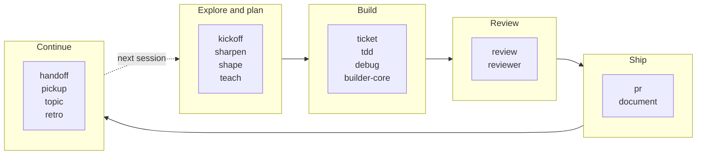

# Skills and agents for Claude Code

[](LICENSE)

**Start here:** [Where each skill fits](docs/lifecycle.md) says which skill to run at the start, middle and end of a session, and takes four everyday situations through them step by step: a new idea, a bug report, stopping for the day, picking up tomorrow.

## Why

Before coding agents, the practices that keep a codebase sound were held in place by people and by friction. The test came first because the team had agreed it would. A second person read the change because the pull request would not merge until they had. The plan came before the build because the build was going to take a week. Writing code was the slow part, so the checks fit around it.

An agent writes the code in minutes. The checks cost what they always did, but next to the agent they feel slow, so they get skipped, or the agent was never asked to do them and nobody noticed. The engineer's work shifts from writing the change to deciding what to build and verifying what came back, and there are more of those decisions, closer together, than there used to be.

Most mistakes in software are not hard decisions made badly. They are easy checks skipped because the moment to make them had passed. The test that would have failed was never written. The reviewer had watched the code being written and saw what was meant, not what was there. The push happened before anyone asked whether it should. This collection takes the engineering and project-management practices that used to live in people and process and builds them into the agent's own workflow, each one at the point where it is cheapest to skip, so that the careful path is also the path of least resistance. Good decisions should be the default, not an act of discipline.

What that looks like in practice:

- In a `ticket` pass, the build does not start until you have seen the plan and said go, and nothing leaves your machine (no push, no pull request, no comment on the ticket) until you have seen the result and said go again.
- In `debug` and `tdd`, a fix is not a fix until a test has failed for the reported cause and then passed.
- The `reviewer` agent sees the diff with no memory of how it was written, and its verdict shows what it ran.
- `handoff` ends a session with a note whose verified checks are commands, so `pickup` can rerun them tomorrow instead of trusting them.

None of this is new. [Built on](#built-on) says where the ideas came from.

## What this is

Seventeen Claude Code skills and eight agents that take a change from first idea to handoff: planning, building, reviewing, shipping, and picking the work up again in a later session.

The difference is in how the collection is built. Every skill that ships a script ships its tests, about 2,800 across the repository, and the lint refuses a script without a `tests/` directory. Every change is reviewed before merge by a reviewer with no context of the build, and code changes also by a second model family. A fix lands with mutation evidence in its pull request: the guarded line reverted, the test shown failing, then passing again with the fix restored. Each skill works from a plain install with no sibling checkout, and the CI check proves it by installing the whole set into an empty home directory.

## How it fits together



Four everyday situations, as the skills you run in order:

- **A new idea.** `kickoff`, then `sharpen` on any requirement still vague, then `shape` once the direction is firm, then tickets in your tracker, each worked with `ticket`.
- **A bug report.** `debug`, then `review`, then `pr`. If the bug has a ticket, `ticket` runs all three.
- **Stopping for the day.** Inside a ticket pass, stop at a go: the card holds everything. On a topic, update the note. Anything else, `/handoff`. Then `/retro` if the session taught you something about your setup.
- **Picking up tomorrow.** `/pickup` from a handoff note, `/topic <slug>` from a topic, or `ticket` with the key and the pass id you noted yesterday.

**[Where each skill fits](docs/lifecycle.md)** is the full guide. It has each of these as a numbered walkthrough, the session on one diagram (what to run at the start, in the middle and at the end), the project from idea to documented code, and three which-one-when tables: `kickoff`, `sharpen` or `shape`; `handoff`, `topic` or the ticket card; `debug`, `tdd` or `ticket`.

The research agents (`researcher`, `api-contract-tracer`, `dependency-auditor`) serve the first stage, and the three `doc-*` agents serve `document`. `humanizer`, `humanizer-finance` and `memory-gardener` are not tied to a stage. For open-ended reading of a codebase, Claude Code's built-in Explore agent is the right tool, and Plan mode outlines the steps for a change; the agents here are for jobs with a fixed contract, such as a draft pull request that is never merged, or a review that shows what it ran.

## Skills

| Skill | What it does | Standalone? |
| --- | --- | --- |
| `debug` | Finds the cause of a bug by reproducing it, testing a hypothesis and isolating the fault, then fixes it behind a test that fails first and passes after. | Yes |
| `document` | Writes documentation pages for a module, service or app by running the doc researcher, writer and verifier agents, and writes only under the repository's docs folder, or the README when you ask for it, through a guard script. | Needs Python 3 and the `doc-researcher`, `doc-writer` and `doc-verifier` agents. The plugin install includes them; otherwise `./install.sh --agent <name>` for each. |
| `handoff` | Writes one redacted, size-capped resume note so a fresh session can continue the work. | Yes (Python 3) |
| `humanizer` | Revises prose to sound natural, or points out robotic phrasing in a draft. | Yes |
| `humanizer-finance` | Applies the writing review to market and financial analysis while preserving useful technical terms and figures. | Needs `humanizer` |
| `kickoff` | Turns an early project idea into a researched plan through questions and review points. | Yes (Python 3) |
| `memory-gardener` | Reconciles a Claude memory directory. It reports stale, duplicated or oversized notes first, and only applies changes after you review the report. | Yes (Python 3) |
| `pickup` | Resumes from a handoff note, lists its verified commands, reruns only the ones you approve, and demotes any that fail or are not rerun. | Yes (Python 3); reads notes written by `handoff` |
| `pr` | Prepares a pull request for the current branch using the project's conventions. | Needs the GitHub CLI (`gh`) |
| `retro` | Reads a session and proposes changes to its environment, such as hooks, checks and instruction files. Edits to skills or rules are shown as diffs and only applied after you approve them. | Yes (Python 3) |
| `review` | Checks code changes for bugs and security problems. | Yes; Python 3 for the optional structured output |
| `shape` | Tests a proposed design for risks and missing considerations before implementation. | Yes |
| `sharpen` | Asks focused questions to clarify requirements and records the answers in a brief. | Yes (Python 3); `config.json` can point it at your own routing documents |
| `tdd` | Applies a test-first loop when you change behavior yourself: a failing test, the smallest passing change, then a refactor, with the red-then-green evidence handed to the reviewer. | Yes |
| `teach` | Explains how a codebase works with a system overview, component tour, and traced example. | Yes; the optional HTML output uses a separate `artifact-design` skill |
| `ticket` | Takes one ticket from intake through a plan, review rounds and an approved outward step to close, stopping for your approval before building and before anything leaves the machine, and keeps a resume card in the repository's ignored scratch. | Needs Python 3 and the `researcher`, `builder-core` and `reviewer` agents; works with a local JSON ticket, and live tickets come through your tracker's connector |
| `topic` | Keeps the notes for an ongoing, focused discussion in one file. | Yes (Python 3); `config.json` can set the notes directory or route topics to a ledger CLI |

## Agents

| Agent | What it does |
| --- | --- |
| `api-contract-tracer` | Follows an API endpoint from its handler to its callers to find mismatched expectations. |
| `builder-core` | Builds one ticket in its own worktree under a floor of safety rules (draft pull request only, never merges) and a turn cap. |
| `dependency-auditor` | Compares dependency versions across projects and flags differences. |
| `doc-researcher` | Gathers code facts and examples for a documentation draft. |
| `doc-verifier` | Checks specific documentation claims against the code. |
| `doc-writer` | Writes a documentation page from a research brief. |
| `researcher` | Answers a focused question about code or an external API with a structured answer, where Explore returns free-form notes. |
| `reviewer` | Reviews a change with no prior context, checks that its tests would fail without it, and backs its verdict with what it ran. Raise its effort per spawn for an adversarial review. |

## Install

You need Claude Code, `git` and `bash`; Python 3 and `gh` only where the tables above say so. Clone the repository, then, from the clone, install the `sdlc` plugin, which carries every skill and agent:

```sh
claude plugin marketplace add .
claude plugin install sdlc@skills
```

A plugin install prefixes every command with the plugin's name, so a command written here as `/review` is invoked with that prefix. Update with `claude plugin update sdlc`.

The alternative is `install.sh`, which copies skills into `~/.claude/skills/` and agents into `~/.claude/agents/` with no marketplace involved. Use one route, not both.

```sh
./install.sh pr                  # one skill        (--all for every skill)
./install.sh --agent reviewer    # one agent        (--all-agents for every agent)
./install.sh --uninstall pr      # also --uninstall --all, --agent <name>, --all-agents
```

To update an `install.sh` install, pull the clone and rerun the install command; the installer replaces the installed copy.

## Writing and checking a skill

If you write your own skill, this is the path:

- Draft and tune it with the `skill-creator` plugin.
- Run `/skill-doctor` to see what a skill costs in context and which installed skills go unused.
- Run `/doctor prompt-audit` to find instructions that conflict with each other.
- Run `claude plugin validate .` to check the plugin's structure.
- Run `claude plugin eval` to check how the skill behaves.
- Run `ci/lint-skills.sh` to check this repository's own contract: a trigger and a NOT-for case in each description, size limits, a `tests/` directory for every skill that ships a script, a README row for every skill and agent, and no hard-coded install paths.
- Run `python3 -m pytest skills/<name>/tests -q` for a skill's tests, and `ci/check.sh` for the whole repository: it installs everything into a throwaway home, checks the installed files for outside references, and runs the lint and the lint's own fixtures.

## Built on

Little here is new. Each line names what this repository took from the source; some skill files carry their own prior-art sections with more detail.

- [pstack](https://github.com/cursor/plugins/tree/main/pstack), by Lauren Tan: the shape of this collection. Small, situational skills that each work on their own and install together as one plugin, so you can adopt one without the rest. In `retro`, the three parallel reviewers with a synthesizer come from `reflect`, and the rule that a repeated mistake becomes a check before it becomes a rule comes from `correct`.
- [Matt Pocock's skills](https://github.com/mattpocock/skills): with pstack, the model for a repository of standalone skills, each one a file you can read in a few minutes and use alone. `sharpen` adapts the relentless one-question interview of `grill-me` and `grilling`, and records what it kept and changed; `retro` takes the idea of a retrospective on the agent's environment, sorted by severity, from his `retro`.
- [Kent Beck, Canon TDD](https://newsletter.kentbeck.com/p/canon-tdd): the red, green, refactor loop in `tdd`, and the rule that a test must fail before the change in `debug` and `builder-core`.
- [Gary Klein, "Performing a Project Premortem"](https://hbr.org/2007/09/performing-a-project-premortem) (Harvard Business Review, 2007): the failure-modes lens in `shape`, which assumes the plan has already failed and asks why.
- [Mutation testing](https://en.wikipedia.org/wiki/Mutation_testing) (DeMillo, Lipton and Sayward, 1978): the `reviewer` agent's step of breaking the guarded line to see a test fail, done by hand rather than with a tool.
- [Anthropic's Agent Skills format](https://code.claude.com/docs/en/skills): the `SKILL.md` file with frontmatter that every skill here is written in.
- [Wikipedia: Signs of AI writing](https://en.wikipedia.org/wiki/Wikipedia:Signs_of_AI_writing), maintained by WikiProject AI Cleanup: the pattern catalog in `humanizer`. The way that catalog is organised was inspired by [blader/humanizer](https://github.com/blader/humanizer), which built on the same page first.
- `kickoff` has its own prior-art table, crediting Harper Reed, Simon Willison, `interview-me`, `spec-kit` and `launch-your-agent` for the interview-then-spec shape.

## Contributing and support

To report a problem or ask a question, open an issue on the repository's GitHub issue tracker. Say which skill or agent it concerns, what you ran, what you expected and what happened.

To propose a change, open a pull request from a branch. Keep it to one change, and add or update a test that fails without it. Before you ask for review, `ci/check.sh`, `ci/lint-skills.sh` and every skill's test suite (`python3 -m pytest skills/<name>/tests -q`) must pass.

## License

MIT. See [LICENSE](LICENSE).
