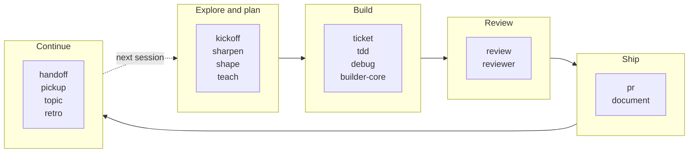

# Skills and agents for Claude Code

[](LICENSE)

Seventeen Claude Code skills and eight agents that take a change from first idea to handoff: planning, building, reviewing, shipping, and picking the work up again in a later session.

The difference is in how the collection is built. Every skill that ships a script ships its tests, about 2,800 across the repository, and the lint refuses a script without a `tests/` directory. Every change is reviewed before merge by a reviewer with no context of the build, and code changes also by a second model family. A fix lands with mutation evidence in its pull request: the guarded line reverted, the test shown failing, then passing again with the fix restored. Each skill works from a plain install with no sibling checkout, and the CI check proves it by installing the whole set into an empty home directory.

## Where each one fits



The research agents (`researcher`, `api-contract-tracer`, `dependency-auditor`) serve the first stage, and the three `doc-*` agents serve `document`. `humanizer`, `humanizer-finance` and `memory-gardener` are not tied to a stage. For open-ended reading of a codebase, Claude Code's built-in Explore agent is the right tool, and Plan mode outlines the steps for a change; the agents here are for jobs with a fixed contract, such as a draft pull request that is never merged, or a review that shows what it ran.

## Skills

| Skill | What it does | Standalone? |
| --- | --- | --- |
| `debug` | Finds the cause of a bug by reproducing it, testing a hypothesis and isolating the fault, then fixes it behind a test that fails first and passes after. | Yes |
| `document` | Writes documentation pages for a module, service or app by running the doc researcher, writer and verifier agents, and writes only under the repository's docs folder, through a guard script. | Needs the `doc-researcher`, `doc-writer` and `doc-verifier` agents. The plugin install includes them; otherwise `./install.sh --agent <name>` for each. |
| `handoff` | Writes one redacted, size-capped resume note so a fresh session can continue the work. | Yes (Python 3) |
| `humanizer` | Revises prose to sound natural, or points out robotic phrasing in a draft. | Yes |
| `humanizer-finance` | Applies the writing review to market and financial analysis while preserving useful technical terms and figures. | Needs `humanizer` |
| `kickoff` | Turns an early project idea into a researched plan through questions and review points. | Yes (Python 3) |
| `memory-gardener` | Reconciles a Claude memory directory. It reports stale, duplicated or oversized notes first, and only applies changes after you review the report. | Yes (Python 3) |
| `pickup` | Resumes from a handoff note, lists its verified commands, reruns only the ones you approve, and demotes any that fail or are not rerun. | Yes (Python 3); reads notes written by `handoff` |
| `pr` | Prepares a pull request for the current branch using the project's conventions. | Needs the GitHub CLI (`gh`) |
| `retro` | Reads a session and proposes changes to its environment, such as hooks, checks and instruction files. Edits to skills or rules are shown as diffs and only applied after you approve them. | Yes (Python 3) |
| `review` | Checks code changes for bugs and security problems. | Yes; Python 3 for the optional structured output |
| `shape` | Tests a proposed design for risks and missing considerations before implementation. | Yes |
| `sharpen` | Asks focused questions to clarify requirements and records the answers in a brief. | Yes (Python 3); `config.json` can point it at your own routing documents |
| `tdd` | Applies a test-first loop when you change behavior yourself: a failing test, the smallest passing change, then a refactor, with the red-then-green evidence handed to the reviewer. | Yes |
| `teach` | Explains how a codebase works with a system overview, component tour, and traced example. | Yes; the optional HTML output uses a separate `artifact-design` skill |
| `ticket` | Takes one ticket from intake through a plan, review rounds and an approved outward step to close, stopping for your approval before building and before anything leaves the machine, and keeps a resume card in the repository's ignored scratch. | Yes (Python 3) with a local JSON ticket; live tickets come through your tracker's connector |
| `topic` | Keeps the notes for an ongoing, focused discussion in one file. | Yes (Python 3); `config.json` can set the notes directory or route topics to a ledger CLI |

## Agents

| Agent | What it does |
| --- | --- |
| `api-contract-tracer` | Follows an API endpoint from its handler to its callers to find mismatched expectations. |
| `builder-core` | Builds one ticket in its own worktree under a floor of safety rules (draft pull request only, never merges) and a turn cap. |
| `dependency-auditor` | Compares dependency versions across projects and flags differences. |
| `doc-researcher` | Gathers code facts and examples for a documentation draft. |
| `doc-verifier` | Checks specific documentation claims against the code. |
| `doc-writer` | Writes a documentation page from a research brief. |
| `researcher` | Answers a focused question about code or an external API with a structured answer, where Explore returns free-form notes. |
| `reviewer` | Reviews a change with no prior context, checks that its tests would fail without it, and backs its verdict with what it ran. Raise its effort per spawn for an adversarial review. |

## Install

You need Claude Code, `git` and `bash`; Python 3 and `gh` only where the tables above say so. The repository is private: clone it with the URL that came with your access, then, from the clone, install the `sdlc` plugin, which carries every skill and agent:

```sh
claude plugin marketplace add .
claude plugin install sdlc@skills
```

A plugin install prefixes every command with the plugin's name, so a command written here as `/review` is invoked with that prefix. Update with `claude plugin update sdlc`.

The alternative is `install.sh`, which copies skills into `~/.claude/skills/` and agents into `~/.claude/agents/` with no marketplace involved. Use one route, not both.

```sh
./install.sh pr                  # one skill        (--all for every skill)
./install.sh --agent reviewer    # one agent        (--all-agents for every agent)
./install.sh --uninstall pr      # also --uninstall --all, --agent <name>, --all-agents
```

To update an `install.sh` install, pull the clone and rerun the install command; the installer replaces the installed copy.

## Writing and checking a skill

If you write your own skill, this is the path:

- Draft and tune it with the `skill-creator` plugin.
- Run `/skill-doctor` to see what a skill costs in context and which installed skills go unused.
- Run `/doctor prompt-audit` to find instructions that conflict with each other.
- Run `claude plugin validate .` to check the plugin's structure.
- Run `claude plugin eval` to check how the skill behaves.
- Run `ci/lint-skills.sh` to check this repository's own contract: a trigger and a NOT-for case in each description, size limits, a `tests/` directory for every skill that ships a script, a README row for every skill and agent, and no hard-coded install paths.
- Run `python3 -m pytest skills/<name>/tests -q` for a skill's tests, and `ci/check.sh` for the whole repository: it installs everything into a throwaway home, checks the installed files for outside references, and runs the lint and the lint's own fixtures.

## License

MIT. See [LICENSE](LICENSE).
