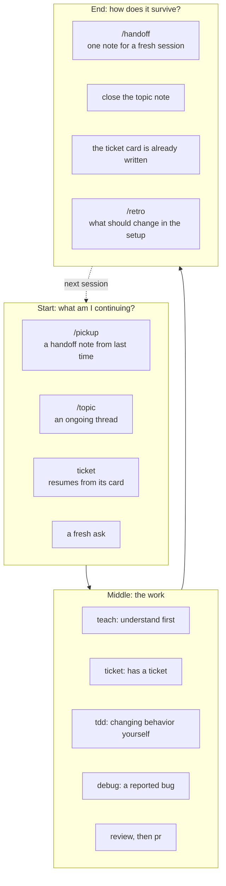
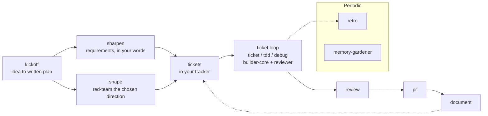

# Where each skill fits

The skills in this repository sit at the points in a piece of work where the quick path and the safe path split: before you build, before you claim a fix, before anything leaves your machine, and when you stop for the day. This page shows those points on two clocks. The session clock runs from opening Claude Code to closing it. The project clock runs from an idea to shipped, documented code, over many sessions.

Each claim here comes from the skill's own `SKILL.md`. Where this page and a skill file disagree, the skill file is right; open an issue.

Four skills run only when you type their command, never on Claude's own initiative: `handoff`, `pickup`, `retro` and `humanizer`. The rest can be picked up from what you say ("why does this fail", "open a PR").

## The session view

A session has a start, a middle and an end. The start decides what you are continuing from. The middle is the work. The end decides how the work survives you closing the terminal.

### Start

- **You have a handoff note.** Run `/pickup`, with the note's path or with nothing to take the newest note. It reads the note without running anything, warns when the repository has a commit newer than the note, and lists the note's verified commands by number. You choose which to rerun. A command that fails, or that you did not rerun, is demoted to a claim, so the session starts from what is true now, not what was true yesterday.
- **You are continuing a thread of work** that is not a ticket: an investigation, a design discussion, a migration you touch once a week. Run `/topic <slug>`. Every touch starts with a reconcile pass over the note's external references (tickets move, PRs merge) and stamps `Last synced` before any work happens.
- **You have a ticket.** Run the `ticket` skill with the key, and with the pass id from last time if that pass is still live. Its first act is to pull the live ticket, then read the card it kept from the last pass, and tell you which phase it resumes at and why. A changed acceptance criterion sends the pass back to planning; a stored plan is never trusted blindly.
- **You have a fresh ask.** Start the work. If it will outlive the sitting, open a topic for it now rather than at the end.

### Middle

- **You need to understand code before changing it.** `teach` gives a mental model, a component tour and one traced request, every claim cited to a file and line. It writes nothing durable; `document` does that.
- **The work has a ticket.** `ticket` runs orient, research, a plan card, a build-and-review loop, then close. It stops twice for your word: before anything is built (the plan go) and before anything leaves the machine (the outward go). The build goes to the `builder-core` agent in its own worktree, where it commits on a branch; the push and the draft pull request wait for the outward go. The review goes to a `reviewer` agent with no context of the build.
- **You are changing behavior yourself**, with no ticket and no builder agent. `tdd` applies: one failing test, seen failing for the right reason, then the smallest change that passes, then a refactor with the suite green. A test that passes before the change is not evidence.
- **Someone reported a bug.** `debug` reproduces it first, states one hypothesis and the observation that would disprove it, isolates the cause, and fixes it behind a test that failed for that cause. It will not call a fix verified without that test.
- **The diff exists and you want it checked.** `review` reads the current changes for bugs and security problems only, one finding per line with a file and line. For a design that has no code yet, that is `shape`, not `review`.
- **The branch is ready.** `pr` pushes it and opens a pull request in the project's own style, with a summary of every commit and a checkable test plan. It does not merge.

### End

Three mechanisms carry work across sessions. Use one per piece of work, not all three.

| You are stopping... | Use | What persists | Who reads it next |
| --- | --- | --- | --- |
| ...in the middle of work that has no ticket and no topic note | `/handoff` | One note with fixed sections: goal, where we stopped, verified command-and-result pairs, claims, decisions, failed approaches, open questions, references, skills to load next. Redacted by pattern, capped at 20 KB, written to the temporary directory, and never inside the repository unless you name that path. | `/pickup` in a fresh session, which reruns only the commands you approve. |
| ...on a thread you have touched before and will touch again | `/topic <slug>` | One note per thread in `.claude/topics/` (or the configured notes directory), with a rewrite-in-place current state, a dated log line per touch, staged drafts for later, and a promote-or-park ledger at close. | The next `/topic <slug>`, which reconciles the note before working. |
| ...inside a ticket pass | Nothing extra; stop at a plan go or an outward go | The ticket's card under `.ticket/` (git-ignored): the plan snapshot, go decisions, review rounds, what was tried, and stamps. | The next `ticket` open, which pulls the ticket and reports the phase it resumes at. |

The `handoff` skill reads and writes no ticket card, ledger, roadmap or memory, and says so. If you find yourself writing a handoff note for a ticket, the card already holds what you are about to write.

Two more end-of-session skills are periodic rather than per piece of work:

- **`retro`** reads what the session did and proposes changes to the environment the next session runs in: a hook, a check, an instruction file. A mistake class counts only when it is seen twice. Edits to skills or rules are shown as diffs, and nothing is applied without your approval. It never writes memory and is never about the person.
- **`memory-gardener`** reconciles Claude's memory directory: stale facts, correction chains, a bloated index. It reports first and applies only after you have read the report. Run it when memory has accreted, not every day.

## The project view

A project moves from an idea to shipped code to documentation, with the ticket loop in the middle repeating once per change.

- **An idea.** `kickoff` interviews you one question at a time on requirements, objectives, constraints, users and success criteria, then researches the technical, market and alternative landscape with cited sources, and writes one plan file. It stops there. It never writes application code, and scaffolding only when you ask for it. It has three checkpoints where you confirm or correct what it heard.
- **A requirement that is still fuzzy.** `sharpen` runs a one-question-at-a-time interview and writes a short requirements brief: must-dos, success criteria quoted in your own words, non-goals, open questions. The brief has no authority until you ratify it, and the skill refuses a topic that is really a bounded choice between a few known options.
- **A direction you are about to commit to.** `shape` fans out five read-only lenses (unknowns, edge cases, alternatives, a pre-mortem, hidden dependencies) and returns one ranked list of what to resolve before building. It changes nothing.
- **Tickets.** Writing them is your tracker's job. This repository has no ticket-writing skill; `ticket` pulls a ticket by key from a tracker connector or from a local JSON file.
- **The loop.** For each ticket, `ticket` runs the pass described above. For a change with no ticket, `tdd` or `debug` carry the same discipline without a builder agent. `ticket` always reviews before the outward go; outside a ticket, run `review` yourself before `pr`.
- **Documentation.** `document` writes pages under the repository's docs folder, and the README when you ask for it, through a researcher, a writer and a verifier agent, and writes only through a guard script. It is for durable pages. A code comment is edited directly; a pull request description is `pr`.
- **The periodic loop.** `retro` after a session that taught you something about the setup. `memory-gardener` when the memory index stops being one line per note.

## Which one when

### kickoff, sharpen or shape

| | `kickoff` | `sharpen` | `shape` |
| --- | --- | --- | --- |
| Start from | An idea, a sentence, a blank page | A known topic whose requirements are not pinned | A direction already chosen |
| Does | Interviews, then researches, then writes a plan file | Interviews only, one question at a time | Red-teams in parallel, read-only |
| Output | One plan file, with cited sources and follow-ups | One requirements brief, a draft until you ratify it | One ranked brief: resolve these first |
| Refuses | To implement anything real | A topic that is really a choice between known options | Not for code that already exists (that is `review`) |
| Next | `sharpen` or `shape` where it points, or build | Whoever plans next cites the brief | Fold the mitigations in and hand it to whoever builds |

Each of these is standalone. `kickoff` recommends `sharpen` and `shape` by name but never requires them.

### handoff and pickup, topic, or the ticket card

| | `handoff` + `pickup` | `topic` | `ticket` card |
| --- | --- | --- | --- |
| Unit | One session | One thread of work, over many sittings | One ticket, over one or more passes |
| Lives in | The temporary directory, mode 0600 | `.claude/topics/<slug>.md` in the repository, or the configured notes directory | `.ticket/<key>.md` in the repository, git-ignored |
| On resume | Verified commands rerun only with your approval; failures demoted to claims | Reconcile pass over external references, then `Last synced` stamped | The live ticket pulled first, then the phase reported with its reason |
| Written by | You, when you run `/handoff` | Every touch of `/topic` | Every step of the pass, atomically |
| Not for | A ticket card, a tracker entry, a roadmap, memory | A throwaway question; a note for a fresh session (that is `handoff`) | Work with no ticket; a session resume note |

### debug, tdd or ticket

| | `debug` | `tdd` | `ticket` |
| --- | --- | --- | --- |
| Start from | A reported failure: a crash, wrong output, a regression | A behavior change you are making yourself | A ticket in a tracker or a local JSON file |
| Who writes code | You, not a delegated agent | You, on the main thread | The `builder-core` agent, in its own worktree |
| Evidence | A reproduction, a test that fails for the reported cause, then passes | A red run before the change and a green run after, per behavior | Review rounds recorded on the card, up to three |
| Stops for you | When the bug will not reproduce (it asks for what is missing), or when the fix needs a design change or touches unrelated behavior | Only when the code cannot be tested without a test-only switch in production code | Twice: before building and before anything leaves the machine |
| Not for | New behavior; reviewing an existing diff | Delegated builds; docs or config with no checker | A change with no ticket; a session resume note |

`debug` and `tdd` share the rule that a test must fail before the fix and pass after. `debug` adds the reproduce-hypothesize-isolate steps in front of it.

## Walkthroughs

### I have a new idea

1. Run `kickoff`. Answer one question at a time; confirm the summary at checkpoint one, the research at checkpoint two, and the write-up at checkpoint three. You end with a plan file and a recommended next step.
2. If a requirement in that file is still vague, run `sharpen` on that one topic in a fresh conversation. Ratify the brief, or say not yet.
3. Once a direction is firm, run `shape` on it. Resolve the top items in its brief before writing code.
4. Write the tickets in your tracker. Work each with `ticket`.

### I have a bug report

1. Run `debug`. It runs the exact failing command and records the output. If it does not reproduce, it asks for what is missing instead of guessing.
2. It states one hypothesis and what would disprove it, then isolates: bisect, instrument, or shrink the input.
3. The fix lands behind a test that failed for the reported cause and now passes. The report names the cause, the evidence, what was ruled out, and what the tests do not cover.
4. Run `review` on the diff, then `pr`. If the bug had a ticket, run `ticket` instead of steps 1 to 4; it delegates the build and keeps the card.

### I'm stopping for the day

1. Inside a ticket pass: finish the current step and stop at a plan go or an outward go. The card holds everything. Note the pass id the skill reported; a later open of the same pass needs it.
2. On a topic: update the note's current state and add a dated log line. Anything half-drafted goes under its staged section so tomorrow steers a draft instead of starting cold. If the thread is finished, close it: every follow-up gets promoted to a tracked surface or parked with a dated reason, and the note gets its close tier and status.
3. Anything else: run `/handoff`. Check the note's verified section lists only commands you actually ran this session; `/pickup` will rerun them.
4. If the session taught you something about your setup, run `/retro`. Approve or reject each proposed diff; nothing applies on its own.

### I'm picking up tomorrow

1. From a handoff note: run `/pickup`. Read the warning if the repository moved since the note. Approve the verified commands worth rerunning. Treat the note's decisions as context, not orders.
2. From a topic: run `/topic <slug>`. Read the reconcile pass before acting; a PR named in the note may have merged overnight.
3. From a ticket: run `ticket` with the key and the pass id you noted yesterday. A pass stopped at a go is still live, and an open without its id is refused as held. Read every reconciliation line it prints before reusing anything stored. Only if yesterday's session crashed does its claim need the release command the refusal prints.
4. Load the skills the note or card names, then continue from where it stopped.
