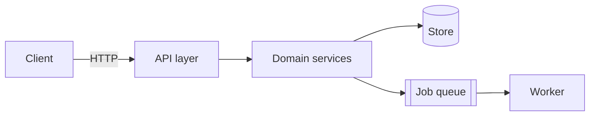
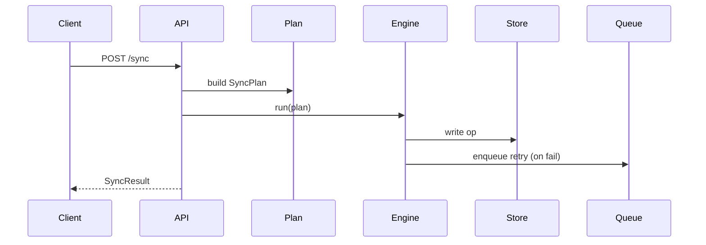

# Teach

Explain code so it *sticks*. The output is understanding — a mental model, a
tour of the parts, and one worked trace — not a pile of prose and not a diff.
If the user needs durable repo documentation, write that as a separate task.
`teach` produces a comprehension session for a person: fast, layered,
drillable, and honest about what it did and didn't read.

## The one idea: three layers, top-down

People learn a system top-down: the shape first, then the parts, then one path
through it in motion. Teach always delivers all three layers — the default order
is top-down, and the only sanctioned reordering is the flow-first variant (Step 1),
where the trace leads and the model/parts are derived to make it legible:

| Layer | Question it answers | Form |
|---|---|---|
| **1 — Mental model** | "What *is* this and how should I think about it?" | 1–2 paragraphs + one high-level diagram |
| **2 — Component walkthrough** | "What are the moving parts and what does each own?" | one short section per component, each anchored to `file:line` |
| **3 — End-to-end trace** | "What actually happens when I do X?" | a numbered trace of one real flow + a sequence/flow diagram |

Each layer is self-contained enough to stop at. A user who only wanted the
mental model can stop after layer 1. Offer that exit explicitly (see Step 4).

## The one rule: cite or don't claim

Every structural claim carries a `path/to/file.ext:LINE` (or `:START-END`)
reference. No "the auth lives in a middleware somewhere" — find it, cite it.
If you can't cite it, you haven't verified it: say so ("not located in this
pass") rather than assert it. Citations are what separate a teach-out from a
plausible-sounding hallucination, and they let the user jump straight to the
code to check you.

## Core architecture: Explore-first, JIT reading

You (the skill) coordinate the reading and synthesize the result. You do NOT read
the whole repo into your own context — that is how a teach-out on a large repo
gets slow and shallow. Instead:

- **Explore-first.** Use the read-only `Explore` sub-agent to map the landscape
  and locate the parts. It reads excerpts, not whole files, and returns the
  conclusion (where things are, with `file:line`), not the file dumps.
- **Just-in-time.** Only pull a file into main context when you need its exact
  text to write a citation or a trace step — and then read just that slice
  (`offset`/`limit`), not the whole file. Explore locates; you confirm the
  load-bearing lines.
- **Fan out per region.** For a multi-component subsystem, spawn one Explore per
  region in parallel (single message, multiple tool calls). Each returns a small
  structured report. You do the *thinking* — stitching the reports into one
  coherent model — while the sub-agents do the *reading*.

Keep main context lean. The moment you catch yourself about to `Read` five files
"just to get oriented," stop and send an Explore instead.

## Step 1 — Interpret the request

Decide four things before exploring. Prefer natural-language cues; flags override.

### Target and scope

| Cue | Scope |
|---|---|
| "explain this repo", "onboard me", "how does this whole thing work" | **whole-repo** — model + top subsystems, breadth over depth |
| "walk me through the auth / the sync engine / the checkout flow" | **subsystem** — one bounded area, full three layers |
| "how does this function / this file work", a single symbol named | **single-unit** — skip the fan-out, read it directly, still give the 3 layers in miniature |
| "trace what happens when a user logs in / when the cron fires" | **flow-first** — layer 3 leads; derive just enough model/parts to make the trace legible |

When ambiguous, ask one sharpening question ("the whole service, or a specific
part?") rather than guessing wrong and touring the wrong thing.

### Depth

- **overview** (default): enough to orient and start reading confidently. One
  diagram per layer, components named not exhaustively dissected.
- **deep** ("really understand", "I'm going to modify this", "in depth"): every
  component gets its contract (inputs/outputs/side-effects), the trace covers
  error/edge branches, more citations.

### Audience

Shapes vocabulary and what you can assume, not the structure:

- **new-to-this-code** (default): assumes general engineering fluency, explains
  *this repo's* choices and jargon.
- **new-to-engineering** ("ELI5", "I'm learning"): more analogy, less jargon,
  smaller steps.
- **domain-expert** ("I know the domain, new to this impl"): skip the domain
  primer, go straight to how *this* code embodies it.

### Diagram medium

Default to **inline mermaid** — it renders in the chat, versions as text, and
needs no tools. Escalate only when warranted:

| Situation | Medium |
|---|---|
| Any diagram that reasonably fits mermaid's graph/flowchart/sequence/ER/class/state types | **inline mermaid** (default) |
| The user wants something to keep, share, or click through; or the walkthrough is large enough that a navigable page beats a wall of chat | **HTML Artifact** (load the `artifact-design` skill first) — a self-contained page with the diagrams + per-node detail, one deliverable the user can reopen |
| Free-form spatial layout, whiteboard-style, or the user says "excalidraw" / "let's sketch this together" and the Excalidraw MCP is available | **Excalidraw MCP** (`create_view` / `save_checkpoint`) |

Don't reach for an Artifact or Excalidraw by default — most teach-outs are best
as inline mermaid the user reads immediately. Offer the richer medium; use it
when the user takes the offer or the scope clearly calls for it.

State your reading back in one line before exploring:

> Teaching [target], [scope] scope, [depth] depth, for [audience], diagrams as [medium]. Say the word to adjust.

## Step 2 — Explore (locate, don't dump)

Send the landscape survey out to Explore before you write anything.

**Whole-repo / subsystem:** spawn Explore agent(s). One prompt template:

> Read-only. Map [target] in this repo for a teaching walkthrough. Return, with
> `file:line` for each: (a) the entry points / how execution starts, (b) the
> major components or modules and the one job each owns, (c) how they talk to
> each other (calls, events, shared state, HTTP), (d) one representative
> end-to-end flow I could trace (name it and list the hops). Read excerpts, not
> whole files. Do not review or critique — just locate and summarize. Breadth:
> [medium | very thorough].

Fan out one Explore per region when the subsystem has clearly separable parts
(e.g. `api/`, `worker/`, `db/`), so they run concurrently. Give each a narrow
region and a shared return shape.

**Single-unit / flow-first:** skip the fan-out. Read the named file/function
slice directly (it's small), and follow its immediate calls JIT.

From the returned map, pick **one real flow** to trace in layer 3 — a concrete,
nameable path (a specific request, command, cron fire, event), not "a generic
operation." Prefer the flow that touches the most components, since it doubles
as the connective tissue for the whole explanation.

## Step 3 — Confirm the load-bearing lines (JIT)

Before you cite a line, confirm it. For each citation and each trace hop that
matters, `Read` just that slice to make sure the line number and the claim
match. This is the only main-context reading you do, and it's surgical:
Explore said *where*, you're verifying the *what* on the handful of lines your
explanation leans on. Don't re-read whole files Explore already summarized.

If confirming reveals Explore was off (wrong file, moved code), correct the map
before writing — a teach-out with a stale citation is worse than none.

## Step 4 — Compose the three layers

Write top-down. Sentence-case headings, direct voice, no warmup (apply the
humanizer generation-mode habits: lead with the point, simple verbs, real names
and paths, no generic conclusions, no emoji decoration).

### Layer 1 — Mental model

One or two paragraphs: what this is, the single metaphor or shape that makes it
click, and the 3–6 nouns the rest of the explanation will use. Then one
high-level diagram — usually a `flowchart` of the major components and their
relationships.



Close layer 1 with the exit offer: *"That's the shape. Want me to go on to the
component walkthrough and a traced example, or is the mental model enough?"* —
so a user who got what they came for doesn't pay for the rest.

### Layer 2 — Component walkthrough

One short subsection per component. For each: what it owns (one line), where it
lives (`dir/ · file.ext:LINE` for the key definition), its inputs and outputs,
and any gotcha worth flagging. In **deep** depth, include the actual contract
(signature, the side effects). Keep each to a few lines — this is a tour, not a
reference manual (write that separately when needed).

> **`SyncEngine`** — owns the reconcile loop; decides what to push/pull.
> `src/sync/engine.ts:42`. In: a `SyncPlan`. Out: a `SyncResult`, plus writes
> to the local store. Gotcha: retries are *not* idempotent above `engine.ts:210` — see the trace.

### Layer 3 — End-to-end trace

Follow the one chosen flow through the code as a numbered list. Each step names
what happens, the function, and the `file:line`, so the reader can single-step
it themselves. Then a `sequenceDiagram` of the same path.

```
1. Request hits `POST /sync` → `routes/sync.ts:18`
2. Handler validates + builds a SyncPlan → `services/plan.ts:64`
3. SyncEngine.run walks the plan → `sync/engine.ts:88`
4. Each op writes through the store → `store/local.ts:120`
5. Failures enqueue a retry job → `sync/engine.ts:205` (the non-idempotent path)
6. Response serialized back → `routes/sync.ts:41`
```



### If the medium is an Artifact or Excalidraw

Compose the same three layers, then render them as the chosen medium instead of
(or in addition to) inline chat:

- **Artifact:** load `artifact-design` first. Build a self-contained HTML page:
  the three layers as sections, mermaid rendered inline, and — if it earns the
  effort — a per-component detail panel. Inline everything (strict CSP: no CDN,
  no external fonts/scripts). This is the "keep and share" deliverable.
- **Excalidraw:** use the MCP (`create_view`, `save_checkpoint`) to lay out the
  component graph and the trace as an editable canvas the user can rearrange.

Always keep the `file:line` citations in whichever medium you emit — they are
the point.

## Step 5 — Close

End with a short "where to go next": the 1–3 files worth opening first to keep
learning, and an offer to zoom into any component or trace a different flow.
Note anything you did *not* read this pass, honestly ("didn't cover the billing
module — say the word"). A teach-out that pretends to be complete when it
sampled is the failure mode to avoid.

## Model tiering

- The caller (this skill): whatever's driving. It holds the coordination
  state and does the synthesis — the thinking.
- `Explore` sub-agents: one tier down is fine; they locate and summarize.
- Use a stronger model for a genuinely large or gnarly subsystem
  where the *synthesis* is the hard part ("how it all fits together," a repo
  spanning many services). Synthesis quality is where the strong model pays off,
  not the reading.

## When to use and when not to

**Use this skill when:**
- The user wants to *understand* code — a repo, a subsystem, a flow, one function.
- Onboarding: "I'm new to this, walk me through it."
- "How does X work / how do these fit together / trace what happens when Y."
- The user asks for an architecture diagram or a mental model of existing code.

**Don't use this skill for:**
- Writing durable documentation to commit (write and verify the document as a
  separate task; this is a session for a person).
- Finding bugs, security holes, or tech debt (run `review` on a diff, or
  investigate a specific misbehavior directly).
- Explaining a *diff* or a PR (just read the diff and explain it directly —
  too lightweight for this).
- Changing code. Teach is read-only; it explains, it doesn't edit.

## Rules

- **Cite or don't claim.** Every structural statement gets a `file:line`. If you
  can't cite it, mark it unverified — never assert it.
- **All three layers, top-down by default.** Mental model → components → trace.
  Don't skip the model to dump components. The one exception is a flow-first
  request, where the trace leads but the model and parts still ship with it.
- **Explore-first, JIT.** Locate with the read-only agent; pull only the
  load-bearing lines into main context. Never bulk-read the repo to "get oriented."
- **Confirm the lines you lean on.** A stale citation is worse than none.
- **Inline mermaid by default.** Reach for an Artifact or Excalidraw only when
  the scope or the user asks for it.
- **Offer the exit after layer 1.** Some users only need the shape.
- **Be honest about coverage.** Say what you sampled and what you skipped.
- **Read-only.** This skill never edits code. If the user then wants a change,
  hand off to the relevant build skill.
